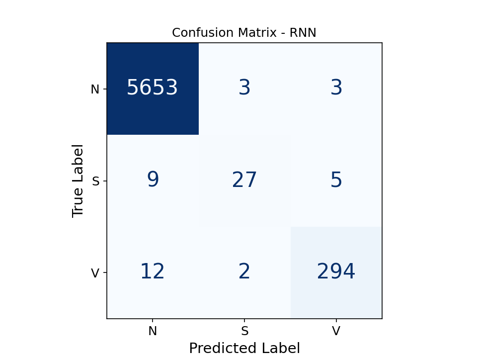
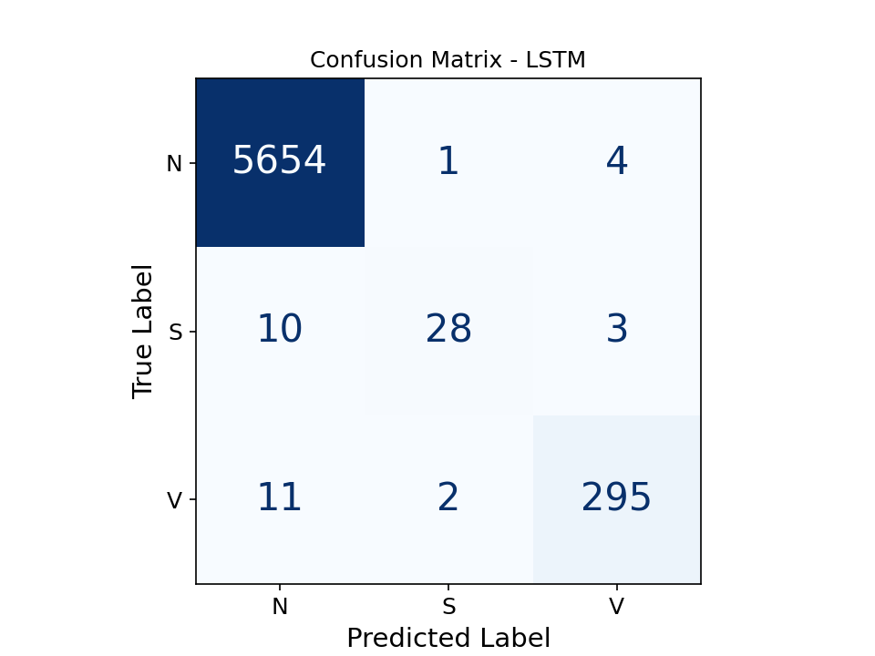
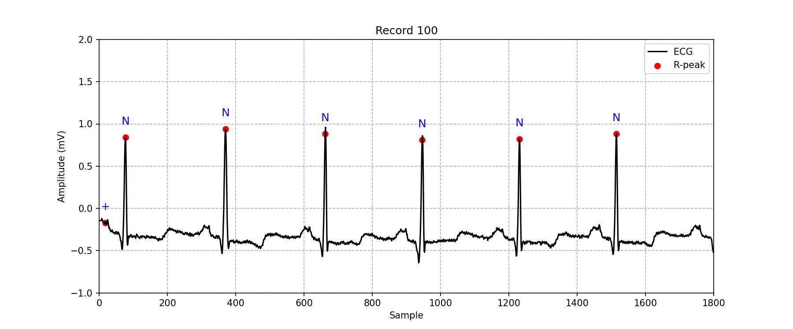

# ECG Arrhythmia Classification with RNN and LSTM

Heartbeat classification into normal, supraventricular and ventricular ectopic beats on MIT-BIH ECG recordings, using eight handcrafted features and recurrent neural networks (RNN and LSTM, in PyTorch) over windows of ten consecutive beats.

Group project for the Machine Learning course of the MSc in Health Data Science (MHEDAS), Universitat Rovira i Virgili.

## Overview

Arrhythmias are abnormal heart rhythms that can increase the risk of stroke, heart failure or sudden cardiac death. The electrocardiogram (ECG) monitors the heart's electrical activity non-invasively, and machine learning can automate the detection of abnormal beats.

This project classifies individual heartbeats into three AAMI classes: Normal (N), Supraventricular ectopic (S) and Ventricular ectopic (V). Eight features describing rhythm, waveform shape and repolarisation are extracted from each beat. A vanilla RNN and an LSTM then use sliding windows of ten consecutive beats to capture temporal patterns, and the two are compared on overall and per-class metrics.

## Results

The dataset is highly imbalanced (94.2% N, 0.7% S, 5.1% V), so macro F1 and per-class recall are reported alongside accuracy. Both models share the same architecture and training setup and differ only in the recurrent layer. The results are on a held-out test set of 6008 ten-beat windows (5659 N, 41 S and 308 V).

| Model | Accuracy | Macro F1 | Weighted F1 | Recall S | Recall V |
|-------|----------|----------|-------------|----------|----------|
| RNN | 0.9943 | 0.9004 | 0.9941 | 0.66 | 0.95 |
| LSTM | 0.9948 | 0.9142 | 0.9946 | 0.68 | 0.96 |

Key findings:

- Both models exceed 99% accuracy, and the LSTM improves macro F1 slightly (0.914 against 0.900).
- Supraventricular beats are the hardest class (only 206 in the dataset): the LSTM detects 28 of 41 in the test set, against 27 for the RNN.
- The two architectures are close, probably because ten-beat windows are short enough for a plain RNN to capture most of the temporal information. The LSTM takes about twice as long at inference.
- These figures are optimistic, because of how the train-test split was built (see [Limitations](#limitations-and-next-steps)).





## Data

The data is the [MIT-BIH Arrhythmia Database](https://physionet.org/content/mitdb/) from PhysioNet: 48 half-hour excerpts of two-channel ambulatory ECG recordings from 47 subjects, digitised at 360 Hz with 11-bit resolution, with every beat annotated by cardiologists.

This repository does not include the data. The notebook downloads the records directly from PhysioNet with the `wfdb` library.

The project uses 14 records that give a representative mix of normal rhythm and clinically significant arrhythmias: 100, 101, 105, 106, 108, 109, 111, 112, 115, 117, 119, 201, 213 and 219, using channel 0 (the MLII lead). After mapping the annotations to three classes, the dataset has 30,162 labelled beats (28412 N, 206 S and 1544 V), and 1057 beats with other annotation symbols were discarded.



## Methods

1. **Label mapping:** beat annotations are mapped to three classes following the AAMI EC57 scheme (N, S and V), and beats with other symbols (such as paced beats or noise) are discarded.
2. **Feature extraction:** eight features per beat from the annotated R-peaks: four rhythm features (current and previous RR interval, their ratio, and a 5-beat local mean RR), three morphology features (R amplitude, QRS duration and QRS energy) and one repolarisation feature (mean ST segment). The first beat of each record uses the median RR interval.
3. **Split and scaling:** a stratified 80/20 split of the beats, with a `StandardScaler` fitted on the training beats only.
4. **Windowing:** sliding windows of 10 consecutive beats, built separately for each record so that no window crosses a record boundary. Each window has shape 10 x 8 and takes the label of its last beat. The windows are then split again with a stratified 80/20 split, and 20% of the training windows are held out for validation.
5. **Models:** a vanilla RNN (`nn.RNN`) and an LSTM (`nn.LSTM`) with one recurrent layer of 64 hidden units and a linear output layer for three classes, with predictions taken from the last time step. Both use cross-entropy loss, the Adam optimiser (learning rate 0.001), batches of 64 and 20 epochs, with a fixed random seed (42).
6. **Evaluation:** accuracy, macro and weighted F1, per-class precision and recall, confusion matrices, training and validation curves, and inference time.

The full methodology, results and discussion are in [`docs/arrhythmia_classification_report.pdf`](docs/arrhythmia_classification_report.pdf).

## Repository structure

```
.
├── docs/
│   └── arrhythmia_classification_report.pdf
├── figures/            
├── notebooks/
│   └── arrhythmia_classification.ipynb
├── README.md
└── requirements.txt
```

## How to run

```bash
git clone https://github.com/cindychenqiu/ecg-arrhythmia-classification.git
cd ecg-arrhythmia-classification
python -m venv .venv
source .venv\Scripts\activate # on macOS/Linux .venv/bin/activate 
pip install -r requirements.txt
jupyter notebook notebooks/arrhythmia_classification.ipynb
```

Tested with Python 3.14.

## Limitations and next steps

- **Overlapping windows across train and test:** consecutive windows share nine of their ten beats, and the windows were split at random, so near-identical windows end up in both the training and test sets. This inflates the results.
- **Patient-level data leakage:** all beats from the 14 records were pooled before splitting, so beats from the same patient appear in both sets. The models can learn patient-specific features, such as QRS shape and typical RR intervals. A patient-independent split, where entire records are held out for testing, is the main next step.
- **Imbalance handled only by stratification:** class weights and resampling (SMOTE) were discussed but not applied, and only 206 supraventricular beats are available.
- **Scaler fitted on beats, not windows:** the scaler was fitted on a beat-level training split before windowing, so some test-window beats contributed to the scaling statistics.
- **Short sequences and a small subset:** ten-beat windows limit the benefit of the LSTM's memory, and 14 records may not represent other patients. Longer windows and multi-layer LSTMs are worth testing.

## Authors and acknowledgements

Group project by Carla Bellido García, Celica Krigul, Keith Megara Osores Vicuña, Ema Stangova and Cindy Chen.  
  
[LinkedIn](https://www.linkedin.com/in/cindychenqiu/) | [GitHub](https://github.com/cindychenqiu)